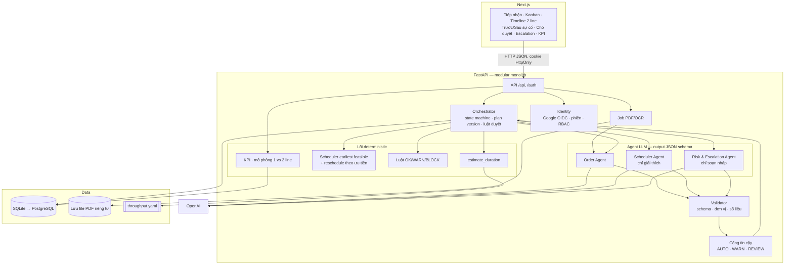
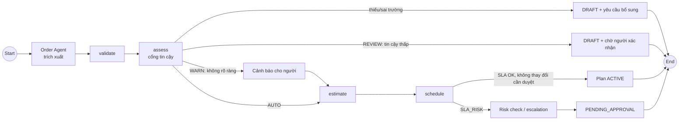
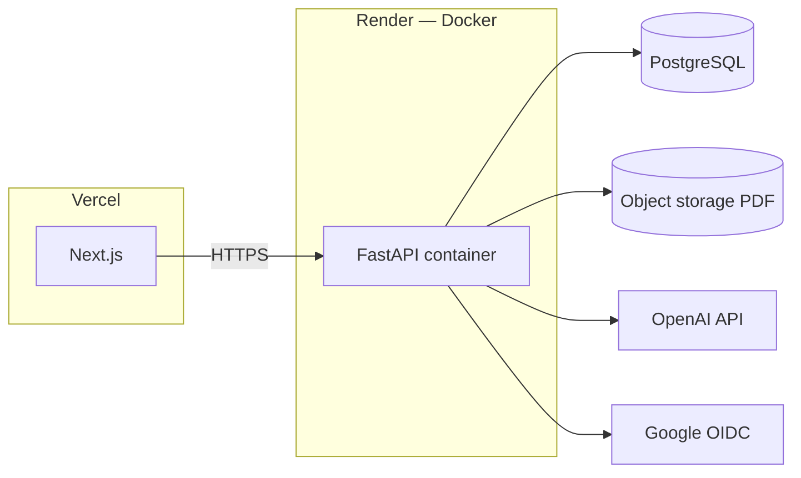

# Architecture Document — ADC Irradiation Work Order

## System Overview

Hệ thống là multi-agent orchestrator với **lõi deterministic**. Các agent LLM chỉ làm việc ở biên: đọc ticket, giải thích lịch, soạn nháp thông điệp. Code thuần tính thời lượng, lịch và mức rủi ro. Orchestrator là nơi **duy nhất** ghi trạng thái, và mọi thay đổi ảnh hưởng khách phải qua cổng duyệt HITL theo plan version. Ở đầu vào, ticket sau OCR/trích xuất **chỉ cần người xác nhận khi độ tin cậy thấp**; kết quả không rõ ràng vẫn đi tiếp nhưng cảnh báo cho người. Triển khai dạng modular monolith: 1 backend FastAPI, 1 frontend Next.js, 1 database, cùng job bất đồng bộ cho PDF/OCR.

Quyết định: [ADR-0001](adrs/0001-architecture-style.md) (kiến trúc), [ADR-0002](adrs/0002-tech-stack.md) (stack), [ADR-0003](adrs/0003-folder-structure.md) (thư mục), [ADR-0004](adrs/0004-deterministic-greedy-scheduling.md) (xếp lịch), [ADR-0005](adrs/0005-hitl-approval-by-plan-version.md) (HITL), [ADR-0006](adrs/0006-google-oauth-authentication.md) (OAuth), [ADR-0007](adrs/0007-confidence-gated-intake-review.md) (cổng tin cậy tiếp nhận).

## Architecture Diagram

## Components

### 1. Frontend (Next.js + TypeScript)
- **Purpose:** giao diện cho Kinh doanh, Điều phối, Quản lý, Admin.
- **Màn chính:** tải PDF + trình xem có highlight vùng nguồn (ADC-001); breakdown thời lượng + "Giả định vận hành" (ADC-002); Kanban + timeline 2 line (ADC-003); khai báo sự cố + Trước/Sau (ADC-004); banner WARN/BLOCK + hàng đợi escalation (ADC-005); Chờ duyệt + Lịch sử (ADC-006); Dashboard KPI (ADC-007); đăng nhập Google + quản lý người dùng (ADC-008).
- **State:** dữ liệu lấy từ API; plan version là khóa lạc quan (409 khi cũ).

### 2. Backend (FastAPI)
- **API Design:** REST, JSON `snake_case`, thời gian UTC ISO 8601 — [`specs/api-contracts.md`](specs/api-contracts.md).
- **Authentication:** Google OAuth 2.0 / OIDC (Authorization Code + PKCE), cookie phiên HttpOnly, RBAC theo [`specs/user-roles.md`](specs/user-roles.md).
- **Modules** (`src/modules/`): `intake`, `estimation`, `scheduling`, `risk`, `orchestration`, `analytics`, `identity` — mỗi module = 1 bounded context trong [`specs/domains.md`](specs/domains.md).

### 3. AI Agents (LangGraph + OpenAI)
- **Agent Type:** graph do code định nghĩa (không phải ReAct tự do). LLM **không** chọn bước tiếp theo, không sinh giờ/line/thứ tự ưu tiên, không có quyền gọi approve.
- **Agents:**

| Agent | Input | Output (schema) | Fallback |
|---|---|---|---|
| Order Agent | Văn bản theo trang (+ toạ độ, độ tin cậy OCR) | `OrderExtraction`: 8 trường × {value, source_kind, page, snippet, confidence} — `confidence` do code gắn từ OCR | Thử lại 1 lần → nhập tay |
| Scheduler Agent | Kết quả `schedule_order` / `reschedule` | `ScheduleExplanation` 1–2 câu | Chỉ hiện bảng số liệu |
| Risk & Escalation Agent | JSON sự kiện trễ | `EscalationDraft` | Mẫu soạn sẵn |

- **Validator:** kiểm tra schema, đơn vị; đối chiếu mọi giờ, line, số liệu trong câu giải thích với dữ liệu.
- **Cổng tin cậy** (`src/modules/intake/confidence.py`, ADR-0007): deterministic, sau validator. Ngưỡng ở mục `ocr` của `throughput.yaml`.
  - **AUTO** — mọi trường rõ ràng → tự chuyển FEASIBILITY_CHECK, không cần người xác nhận.
  - **WARN** — không rõ ràng (OCR vùng xám 0,8–0,9, giá trị AI suy luận/mặc định, file trùng) → vẫn đi tiếp, tạo cảnh báo cho người xem lại.
  - **REVIEW** — tin cậy thấp (OCR < 0,8, không chắc ranh giới ticket) → giữ DRAFT, người xác nhận trường bị gắn cờ rồi submit (HITL).
- **Luồng tiếp nhận** (`src/agents/graph.py`):

### 4. Database
- **Type:** SQLite (dev/test) → PostgreSQL (staging/prod); SQLAlchemy 2 + Alembic.
- **Tables:** `ticket_files`, `ingest_jobs`, `tickets`, `work_orders`, `field_extractions`, `clarification_requests`, `lines`, `plan_versions`, `schedule_slots`, `plan_changes`, `incidents`, `incident_affected_orders`, `risk_checks`, `escalations`, `state_history`, `audit_log` (chỉ ghi thêm), `kpi_snapshots`, `users`, `sessions`, `allowed_domains`. ER tổng hợp: `specs/domains.md` §8; cột chi tiết: mục *Mô hình dữ liệu* của từng `tasks/ADC-*.md`.

### 5. Cấu hình mô phỏng
- `src/config/throughput.yaml`: `setup_min`, `min_per_kg`, `min_per_m3`, `buffer_pct`, `round_to_min`, `density_factor`, `dose_factor`, giờ vận hành line, ngưỡng rủi ro, ngưỡng OCR (`low_confidence_threshold`, `warn_confidence_threshold`). Đổi tham số tại đây, không hard-code.
- Không dùng vector store / RAG (ADC-001).

## Data Flow

1. Kinh doanh tải PDF → API lưu file, tạo job (202) → đọc text layer / OCR → tách ticket.
2. Orchestrator tạo work order DRAFT → Order Agent trích xuất → Validator → cổng tin cậy.
3. Thiếu trường → yêu cầu bổ sung; tin cậy thấp → giữ DRAFT chờ người xác nhận; không rõ ràng → cảnh báo cho người nhưng vẫn đi tiếp.
4. Đủ trường và không cần xác nhận → tự chuyển FEASIBILITY_CHECK → `estimate_duration` → `schedule_order` (earliest feasible, hòa → Line A).
5. Không ảnh hưởng SLA → plan version ACTIVE; ngược lại → Risk (WARN/BLOCK, escalation) và plan PENDING_APPROVAL.
6. Sự cố line → tìm slot chồng lấn → sắp VIP → Khẩn → Thường → dời sang line còn lại → plan mới chờ duyệt.
7. Người duyệt (Quản lý / Kinh doanh) duyệt → version mới ACTIVE, version cũ SUPERSEDED; mọi bước ghi `state_history` + `audit_log`.

## Deployment Architecture

Hai môi trường staging và production, mỗi môi trường có OAuth client riêng. `POST /api/demo/reset` chỉ bật ở demo/staging.

## Security

- Secret (OpenAI, Google client secret) chỉ nằm trong biến môi trường; không commit `.env`, PDF thật của khách.
- Kiểm tra MIME + nội dung file, giới hạn 10 MB / 20 trang; không thực thi JS/tệp nhúng trong PDF; file truy cập qua link có thời hạn.
- Ẩn danh tên/SĐT/email trước khi gửi LLM/OCR bên ngoài.
- Cookie HttpOnly, Secure, SameSite=Lax; hết hạn sau 12 giờ không hoạt động; không lưu access/refresh token Google.
- RBAC ở API: 401 chưa đăng nhập, 403 PENDING/DISABLED hoặc sai vai trò.
- Audit log chỉ ghi thêm.

## Design Decisions

| Decision | Choice | Reason |
|----------|--------|--------|
| Kiến trúc | Orchestrator code + agent như tool + lõi deterministic | Tái lập, kiểm chứng, AI lỗi không làm sai lịch (ADR-0001) |
| Ước tính | Công thức tuyến tính cấu hình, làm tròn 15' | Không có dữ liệu thật, không được tính liều thật (ADR-0004) |
| Xếp lịch | Greedy earliest feasible | Dễ giải thích; OR-Tools để sau MVP (ADR-0004) |
| Duyệt | Theo cả plan version | 1 cổng duyệt khi 1 sự cố ảnh hưởng nhiều đơn (ADR-0005) |
| Xác nhận ticket | Chỉ HITL khi tin cậy thấp; không rõ ràng → cảnh báo | Bớt "mỏi duyệt", người tập trung vào ticket đáng ngờ (ADR-0007) |
| Xác thực | Google OIDC + PKCE | Không lưu mật khẩu (ADR-0006) |
| Framework | FastAPI + LangGraph | Khung template, Python chung cho PDF/OCR (ADR-0002) |
| Frontend | Next.js | Kanban, timeline, trình xem PDF có highlight (ADR-0002) |
