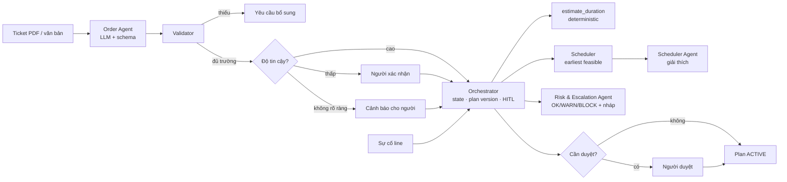

# ADC Irradiation Work Order — MFG 08

> Ticket PDF lộn xộn + 2 line chiếu xạ + sự cố line → **control tower multi-agent** xếp lịch deterministic, tái lập lịch theo ưu tiên và escalation **do con người phê duyệt** — cho điều phối sản xuất và kinh doanh của dịch vụ chiếu xạ kiểu ADC.

Hệ thống tiếp nhận ticket PDF, ước tính thời lượng từ giả định mô phỏng, xếp lịch 2 line (A/B), xử lý sự cố line bằng tái lập lịch theo ưu tiên, cảnh báo rủi ro và soạn thông điệp khách hàng chờ người duyệt.

> ⚠️ Mô hình throughput là **giá trị giả lập** phục vụ demo điều phối. Đây không phải thông số vật lý chiếu xạ: hệ thống không điều khiển máy và không tính liều thật.

## Vấn đề

Kinh doanh hứa giờ trả với khách, trong khi năng lực line và kho được kiểm tra riêng. Khi một line dừng, nhóm phải tự tìm đơn bị ảnh hưởng và dựng lại lịch bằng tay. Bốn rủi ro: **trả hàng trễ**, **dùng line kém hiệu quả**, **đánh đổi ưu tiên sai**, **nhận đơn mới khi đã quá tải**. Chi tiết: [`specs/product-vision.md`](specs/product-vision.md).

## Giải pháp

| Tính năng | Đặc tả | FR |
|---|---|---|
| Tiếp nhận ticket PDF (văn bản + scan), trích 8 trường kèm vùng nguồn, yêu cầu bổ sung | [ADC-001](tasks/ADC-001-ticket-intake-pdf.md) | FR 01–02 |
| Ước tính thời lượng từ công thức cấu hình (không dùng AI) | [ADC-002](tasks/ADC-002-duration-estimation.md) | FR 03 |
| Xếp lịch Line A/B earliest feasible, Kanban + timeline | [ADC-003](tasks/ADC-003-line-scheduling-kanban.md) | FR 04–05 |
| Sự cố line → tái lập lịch VIP → Khẩn → Thường | [ADC-004](tasks/ADC-004-incident-rescheduling.md) | FR 06–09 |
| Cảnh báo/chặn đơn mới OK/WARN/BLOCK, escalation, AI soạn thông điệp | [ADC-005](tasks/ADC-005-risk-control-escalation.md) | FR 10, 11, 14 |
| Duyệt HITL theo plan version, state machine, audit log | [ADC-006](tasks/ADC-006-hitl-approval-plan-version-audit.md) | FR 12 |
| KPI và so sánh 1 line vs 2 line | [ADC-007](tasks/ADC-007-kpi-dashboard-line-comparison.md) | FR 13 |
| Đăng nhập Google, RBAC | [ADC-008](tasks/ADC-008-google-auth.md) | — |

**USP:** khi Line A gặp sự cố, hệ thống kiểm tra năng lực Line B, bảo vệ đơn ưu tiên cao, chặn nhận đơn mới rủi ro và escalate các ca trả trễ cho kinh doanh.

**Nguyên tắc:** AI xử lý đầu vào lộn xộn, điều phối và giải thích; luật deterministic tính lịch; con người duyệt mọi thay đổi ảnh hưởng khách.

## Người dùng

- **Chính:** Kinh doanh / CSKH (tải PDF, xử lý escalation), Điều phối sản xuất / Trưởng ca (xếp lịch, khai báo sự cố).
- **Phụ:** Quản lý vận hành (duyệt plan, override BLOCK, xem KPI), Quản trị hệ thống. Chi tiết: [`specs/user-roles.md`](specs/user-roles.md).

## Kiến trúc tóm tắt



Chi tiết: [`ARCHITECTURE.md`](ARCHITECTURE.md) · Quyết định kiến trúc: [`adrs/`](adrs/).

## Tech stack

| Lớp | Công nghệ |
|---|---|
| Backend | Python 3.11, FastAPI, Uvicorn |
| Điều phối agent | LangGraph (graph do code định nghĩa) |
| LLM | OpenAI `gpt-4o-mini` qua LangChain, structured output |
| Giả định mô phỏng | YAML — `src/config/throughput.yaml` |
| PDF / OCR | PyMuPDF hoặc pdfplumber, Tesseract (chốt ở T-048) |
| Database | SQLite (dev) → PostgreSQL, SQLAlchemy + Alembic |
| Frontend | Next.js + TypeScript (`frontend/`) |
| Xác thực | Google OAuth 2.0 / OIDC + PKCE |
| Lint / test | ruff, pytest |
| DevOps | Docker, GitHub Actions; Render + Vercel |

Xem [ADR-0002](adrs/0002-tech-stack.md).

## Bắt đầu

Yêu cầu: Python 3.11, Git; Docker (tùy chọn); Node.js 20+ khi làm frontend.

```bash
# 1. Cài môi trường
python3.11 -m venv .venv
source .venv/bin/activate          # Windows: .venv\Scripts\activate
pip install -r requirements.txt

# 2. Biến môi trường
cp .env.example .env               # điền OPENAI_API_KEY và AI_LOG_API_KEY

# 3. Hook ghi log AI — chạy 1 lần sau khi clone (bắt buộc để chấm bài)
bash scripts/setup_hooks.sh                                      # Linux / macOS / Git Bash
powershell -ExecutionPolicy Bypass -File scripts\setup_hooks.ps1 # Windows PowerShell

# 4. Chạy
make run                           # http://localhost:8000/docs
make test
make lint
```

Hoặc chạy bằng Docker: `docker compose up --build`.

`AI_LOG_API_KEY`: mỗi thành viên tự tạo key riêng tại [dashboard Phoenix](https://phoenix.note.transformerlabs.ai/api-keys). Giá trị trong `.env.example` chỉ là placeholder.

Thử nhanh ví dụ chuẩn của ADC-002 (kết quả 180 phút):

```bash
curl -s localhost:8000/api/estimate -H 'content-type: application/json' -d '{
  "product_group": "spice", "quantity": 120, "pkg_length_cm": 40, "pkg_width_cm": 30,
  "pkg_height_cm": 25, "pkg_weight_kg": 8, "required_dose_kgy": 10}'
```

## Cấu trúc repo

```
├── specs/          # Đặc tả sản phẩm & nghiệp vụ — NGUỒN SỰ THẬT
│   ├── product-vision.md   domains.md   user-roles.md   features.md   api-contracts.md
├── adrs/           # 0001 kiến trúc · 0002 stack · 0003 thư mục · 0004 xếp lịch · 0005 HITL · 0006 OAuth · 0007 cổng tin cậy tiếp nhận
├── tasks/          # ADC-001 … ADC-008 (Động lực → Thiết kế → Kế hoạch) + _template.md
├── planning/       # backlog.md (T-001 … T-053) · sprints/sprint-01 … sprint-06
├── src/            # Backend — xem src/README.md
│   ├── api/  agents/  modules/{intake,estimation,scheduling,risk,orchestration,analytics,identity}/
│   ├── services/  config/throughput.yaml  seed/
│   └── main.py  settings.py
├── frontend/       # Next.js (khởi tạo ở T-007)
├── tests/          # pytest, song song với src/modules
├── docs/           # workflow, roadmap, demo-scenarios, team, links, bug-tracking, architecture_diagram
│   └── guide/      # Technical Book của AI20K (không sửa)
├── eval/           # Bằng chứng đánh giá — Metrics PRD
├── presentation/   # Slide, video demo
├── scripts/        # Hook ghi log AI (template)
├── AGENTS.md       # Luật chơi cho AI & team — đọc trước tiên
├── ARCHITECTURE.md · JOURNAL.md · WORKLOG.md
└── Dockerfile · docker-compose.yml · Makefile · requirements.txt
```

## Lộ trình 6 tuần

| Tuần | Sprint | Mốc | Trọng tâm |
|---|---|---|---|
| W1 | 1 | M1 Charter, M2 Gặp đối tác | Charter, kiến trúc, schema, cấu hình throughput, hàm ước tính, seed |
| W2 | 2 | M3 Thiết kế giải pháp | Upload + đọc PDF/OCR, validator, xếp lịch earliest feasible, state machine, audit log |
| W3 | 3 | M4 **Demo 1** | Order Agent, Orchestrator, màn tiếp nhận, Kanban, timeline 2 line |
| W4 | 4 | M5 Xử lý phản hồi Demo 1 | Sự cố Line A, tái lập lịch theo ưu tiên, WARN/BLOCK, escalation, luồng duyệt HITL |
| W5 | 5 | M6 **Demo 2** | Hàng đợi escalation + AI soạn thông điệp, KPI, so sánh 1 vs 2 line, Google Auth |
| W6 | 6 | M7 Bản chính thức, M8 Đánh giá cuối kỳ | Production, kiểm thử cuối, tài liệu, pitch |

Chi tiết: [`docs/roadmap.md`](docs/roadmap.md) · [`planning/backlog.md`](planning/backlog.md).

## Quy trình làm việc

1. Đọc [`specs/product-vision.md`](specs/product-vision.md), sau đó [`AGENTS.md`](AGENTS.md).
2. Xem sprint hiện tại trong `planning/sprints/`.
3. Nhận mã việc `T-xxx` trong `planning/backlog.md` và đọc file đặc tả `tasks/ADC-xxx-*.md` tương ứng.
4. Branch `feature/T-027-...`, commit `feat(scheduling): ... [T-027]`, PR `[T-xxx] Mô tả` (xem AGENTS.md §5).

Giao việc cho AI agent (Claude Code, Codex, Cursor đọc `AGENTS.md`; `CLAUDE.md` và `.github/copilot-instructions.md` trỏ về đó):

```
Đọc AGENTS.md. Thực hiện T-033 trong tasks/ADC-004-incident-rescheduling.md.
Chỉ sửa src/modules/scheduling/ và tests/modules/scheduling/.
Trình bày kế hoạch trước; khi xong liệt kê TC đã pass.
```

## 10 deliverables cho Demo Day

| # | Deliverable | Vị trí |
|---|---|---|
| 1 | Source code | `src/`, `frontend/` |
| 2 | README | file này |
| 3 | Architecture diagram | `ARCHITECTURE.md`, `docs/architecture_diagram.md` |
| 4 | AI logs | LangSmith + hook ghi log AI (`.ai-log/`) |
| 5 | Live URL | `docs/links.md` |
| 6 | Video demo | `presentation/` |
| 7 | Pitch deck | `presentation/` |
| 8 | Development journal | `JOURNAL.md` |
| 9 | Worklog | `WORKLOG.md` |
| 10 | Evaluation evidence | `eval/results/report.md` |

Checklist đầy đủ: `docs/guide/deliverables/checklist.md`. Technical Book: <https://phoenix.note.transformerlabs.ai/technical-book>.

## AI usage logging

Mọi prompt được ghi vào `.ai-log/session.jsonl` và tự động gửi lên grading server ở bước pre-push.

| Công cụ | Cấu hình |
|---|---|
| Claude Code | `.claude/settings.json` |
| Cursor | `.cursor/hooks.json` |
| OpenAI Codex | quét `~/.codex/sessions` khi `git push` |
| Gemini CLI | `.gemini/settings.json` |
| GitHub Copilot | `.github/hooks/hooks.json` |
| Antigravity IDE | `.agents/hooks.json` |

Dùng ChatGPT hay công cụ web khác thì log thủ công:

```bash
bash scripts/_pyrun.sh scripts/log_manual.py --tool chatgpt --prompt "What you asked"
```

## Nguồn tài liệu gốc

- ADC Irradiation Work Order Project Brief (.docx), PRD (.docx)
- Team project management template (.xlsx): các sheet Đặc tả tính năng, Backlog, Lộ trình, Thành viên, Theo dõi lỗi, Đường link, Tài liệu

Link quan trọng: [`docs/links.md`](docs/links.md) · Thành viên: [`docs/team.md`](docs/team.md) · Kịch bản demo: [`docs/demo-scenarios.md`](docs/demo-scenarios.md)

## License

[MIT](LICENSE)
