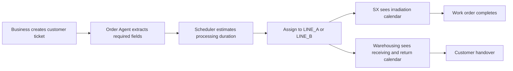
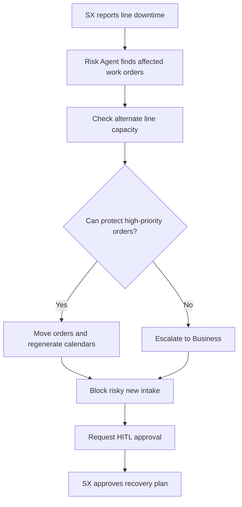

# ADC Workflow Model

## Actors

| Actor | Responsibility |
|---|---|
| Business | Create customer tickets, track customer promises, receive escalation notices |
| SX Production | Monitor incoming tickets, irradiation calendars, line status, incidents, and HITL approvals |
| Warehousing | Prepare receiving, staging, and return handover based on shared ticket and SX calendar state |

## Normal Flow

## Incident Flow

## Agent Responsibilities

| Agent | Responsibility |
|---|---|
| Order Agent | Convert business ticket into structured work-order input |
| Scheduler Agent | Estimate duration and assign orders to irradiation lines |
| Risk/Incident Agent | Detect affected orders, move work, block intake, and mark escalations |
| Notification Agent | Surface alerts to Business, SX, and Warehousing |

