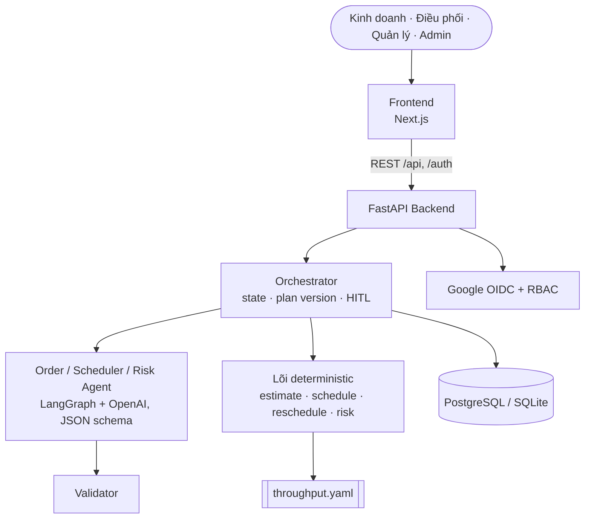
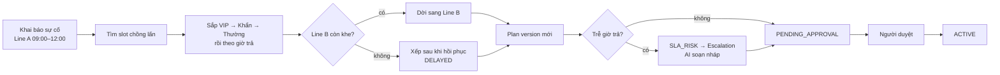

# Architecture Diagram — ADC Irradiation Work Order

Bản đầy đủ: [`ARCHITECTURE.md`](../ARCHITECTURE.md).

## System Overview

## Luồng sự cố Line A (USP)

## Component Details

| Component | Technology | Purpose |
|-----------|-----------|---------|
| Frontend | Next.js + TypeScript | Tiếp nhận, Kanban, timeline, duyệt, escalation, KPI |
| Backend | FastAPI | API, job PDF/OCR |
| Orchestrator | Code + LangGraph | Ghi trạng thái, gọi agent, áp luật duyệt |
| Agents | OpenAI `gpt-4o-mini`, structured output | Trích xuất, giải thích, soạn nháp |
| Lõi deterministic | Python thuần | Thời lượng, lịch, rủi ro, KPI |
| Database | SQLite → PostgreSQL | Work order, plan version, audit |
| Auth | Google OAuth 2.0 / OIDC | Đăng nhập, RBAC |
