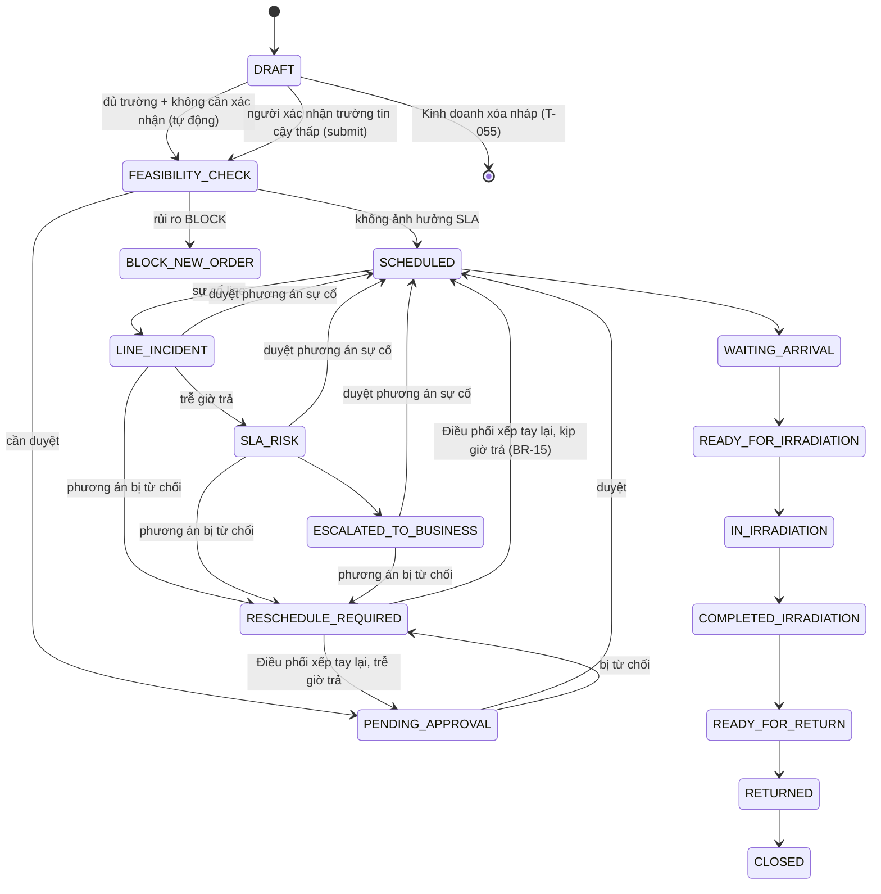
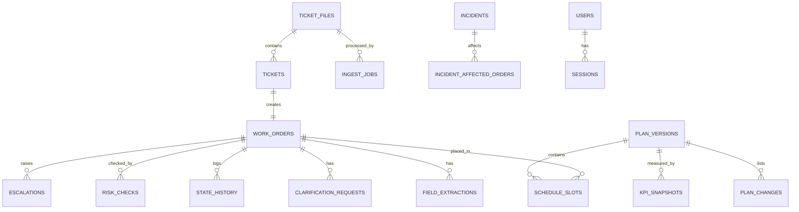

# Domains — Mô hình nghiệp vụ

## 1. Bounded contexts

| Context | Trách nhiệm | Agent / Module | Đặc tả |
|---|---|---|---|
| Intake | Nhận PDF/văn bản, trích xuất, kiểm tra trường | Order Agent + Validator | ADC-001 |
| Estimation | Tính thời lượng từ giả định cấu hình | `estimate_duration` (thuần, không AI) | ADC-002 |
| Scheduling | Xếp lịch Line A/B, tái lập khi sự cố | Scheduler (deterministic) + Scheduler Agent (giải thích) | ADC-003, ADC-004 |
| Risk | Mức rủi ro đơn mới, escalation, nháp thông điệp | Risk & Escalation Agent | ADC-005 |
| Orchestration | State machine, plan version, duyệt HITL, audit | Orchestrator (code, không phải LLM tự do) | ADC-006 |
| Analytics | KPI, mô phỏng 1 vs 2 line | KPI service | ADC-007 |
| Identity | Google OAuth, phiên, RBAC | Auth module | ADC-008 |

## 2. Thuật ngữ (Ubiquitous Language)

| Thuật ngữ | Định nghĩa |
|---|---|
| Ticket | Yêu cầu dịch vụ của khách (PDF, văn bản dán, nhập tay) |
| Work order | Lệnh sản xuất tạo từ 1 ticket |
| Line A / Line B | Hai line chiếu xạ |
| Slot | Khoảng [start, end] của 1 work order trên 1 line trong 1 plan version |
| Plan version | Phiên bản lịch của cả 2 line; chỉ 1 version ACTIVE tại một thời điểm |
| Incident | Sự cố line: line, thời điểm bắt đầu, thời gian dừng dự kiến |
| Requested return | Giờ trả khách yêu cầu — mốc đo SLA |
| SLA risk | Giờ xong dự kiến > giờ trả yêu cầu |
| Escalation | Mục việc cho kinh doanh xử lý với khách về đơn trễ |
| HITL | Human-in-the-loop — người phê duyệt thay đổi ảnh hưởng khách; ở tiếp nhận chỉ áp dụng khi độ tin cậy thấp |
| Mức xem xét tiếp nhận | AUTO (tự đi tiếp) · WARN (đi tiếp + cảnh báo cho người) · REVIEW (giữ DRAFT, người xác nhận) — ADR-0007 |
| Cảnh báo tiếp nhận | Cờ trên work order khi kết quả trích xuất không rõ ràng; không chặn luồng, người xem và xác nhận đã đọc |
| Priority | NORMAL (Thường) · URGENT (Khẩn) · VIP |

## 3. Dữ liệu đầu vào của ticket (8 trường)

| Trường | Ví dụ | Mục đích |
|---|---|---|
| Product type / tên sản phẩm | Gia vị, hải sản, trái cây, vật tư y tế | Chọn hồ sơ mật độ & xử lý |
| Quantity | 120 thùng | Tính tổng tải |
| Package dimensions | 40 × 30 × 25 cm | Tính thể tích |
| Package weight | 8 kg | Tính tổng khối lượng |
| Required dose | 5 / 10 / 25 kGy | Điều chỉnh thời lượng |
| Priority | Thường / Khẩn / VIP | Thứ tự tái lập lịch |
| Expected arrival | 09:00 | Giờ bắt đầu sớm nhất |
| Requested return | 16:00 | Đo rủi ro SLA |

Bắt buộc: tên sản phẩm, số lượng, quy cách (**kích thước + khối lượng thùng**, cả hai cần cho công thức §4), liều, giờ trả — thiếu → yêu cầu bổ sung (FR 02).

## 4. Mô hình throughput mô phỏng

> Giá trị **giả lập**, không phải vật lý chiếu xạ thật. Cấu hình ở `src/config/throughput.yaml`.

```
total_weight  = quantity × pkg_weight_kg
total_volume  = quantity × L × W × H            (m³)
weight_load   = total_weight × min_per_kg × density_factor[product_group]
volume_load   = total_volume × min_per_m3
dose_load     = (weight_load + volume_load) × (dose_factor[dose] − 1)
buffer        = (setup + weight_load + volume_load + dose_load) × buffer_pct
duration      = setup + weight_load + volume_load + dose_load + buffer   → làm tròn lên bội 15 phút
```

Ví dụ: 120 thùng × 8 kg, 40×30×25 cm, gia vị, 10 kGy → 960 kg, 3.6 m³ → 30 + 48 + 36 + 42 + 15.6 ≈ 172' → **180 phút**.

## 5. State machine của work order

| Nhóm | Trạng thái |
|---|---|
| Normal | DRAFT → FEASIBILITY_CHECK → PENDING_APPROVAL → SCHEDULED → WAITING_ARRIVAL → READY_FOR_IRRADIATION → IN_IRRADIATION → COMPLETED_IRRADIATION → READY_FOR_RETURN → RETURNED → CLOSED |
| Exception | LINE_INCIDENT, SLA_RISK, RESCHEDULE_REQUIRED, ESCALATED_TO_BUSINESS, BLOCK_NEW_ORDER |



> Bảng chuyển hợp lệ đầy đủ ở `src/modules/orchestration/state_machine.py` (T-040, chốt 02/10/2026). Đơn đang vận hành (WAITING_ARRIVAL → …) bị dời slot do sự cố / priority override giữ nguyên trạng thái. Override BLOCK_NEW_ORDER (Quản lý, BR-07) chưa có chuyển ra — chờ API trong contract.

Plan version: `PROPOSED → PENDING_APPROVAL → ACTIVE → SUPERSEDED` hoặc `REJECTED`.
Escalation: `OPEN → DRAFTED → APPROVED → CLOSED`.
User: `PENDING → ACTIVE → DISABLED`.

## 6. Quy tắc nghiệp vụ

| Mã | Quy tắc | Nguồn |
|---|---|---|
| BR-01 | Thiếu trường bắt buộc → không vào FEASIBILITY_CHECK | FR 02 |
| BR-02 | Thời lượng chỉ tính bằng công thức cấu hình; loại sản phẩm/liều không có trong cấu hình → lỗi, không lấy mặc định | ADC-002 |
| BR-03 | Giờ bắt đầu sớm nhất = max(expected_arrival, hiện tại); chọn line kết thúc sớm nhất, hòa → Line A | ADC-003 |
| BR-04 | Không có 2 slot chồng lấn trên cùng line trong bất kỳ plan version nào | ADC-003 |
| BR-05 | Tái lập lịch sự cố: sắp VIP → Khẩn → Thường, cùng mức thì giờ trả sớm hơn trước | FR 09 |
| BR-06 | Giờ xong > giờ trả → SLA_RISK → escalation | FR 11 |
| BR-07 | Đơn mới: OK / WARN (kịp giờ trả nhưng đẩy đơn khác trễ — cần duyệt) / BLOCK (không kịp giờ trả dù xếp sớm nhất — Quản lý override kèm lý do) | FR 10 |
| BR-08 | Thay đổi ảnh hưởng khách không được ACTIVE khi chưa duyệt | FR 12 |
| BR-09 | Chỉ 1 plan version ACTIVE; duyệt version mới → version cũ SUPERSEDED | ADC-006 |
| BR-10 | Audit log chỉ ghi thêm | ADC-006 |
| BR-11 | Plan mô phỏng (`is_simulation`) không bao giờ ACTIVE | ADC-007 |
| BR-12 | Có trường tin cậy thấp (OCR < `low_confidence_threshold` hoặc `OCR_LOW`) hoặc không chắc ranh giới ticket → giữ DRAFT, người phải xác nhận; ngược lại đủ trường → tự vào FEASIBILITY_CHECK, không cần xác nhận | ADR-0007 |
| BR-13 | Kết quả không rõ ràng (OCR vùng xám, `INFERRED`, `DEFAULT`, file trùng) → không chặn, tạo cảnh báo tiếp nhận cho người | ADR-0007 |
| BR-14 | Line chạy 24/7 nhưng ưu tiên ca ngày (06:00–22:00 giờ địa phương): chỉ đơn khẩn cấp (Khẩn, VIP) được chạy ca đêm; đơn còn lại phải nằm trọn trong 1 ca ngày — không đủ chỗ thì dời sang đầu ca hôm sau, không cắt đôi lệnh; dài hơn cả ca → không xếp được. Giờ ca và nhóm ưu tiên chạy đêm cấu hình ở `lines.shifts` (`throughput.yaml`) | ADC-003 (T-054) |
| BR-15 | Điều phối được xếp / sửa lịch thủ công (chọn line + giờ bắt đầu) cho đơn chưa chạy: không chồng lấn (BR-04, từ chối và nêu đơn đang chiếm), tuân ca (BR-14), không trước giờ hàng đến / hiện tại; giờ xong > giờ trả → thay đổi giờ trả, cần duyệt (BR-08) | ADC-003 |

## 7. Giả định cần xác nhận với đối tác

- Đơn đang chiếu dở trên line hỏng phải chạy lại từ đầu (ADC-004).
- Ca làm của line (BR-14, nhóm chốt tạm 01/10/2026): ca ngày 06:00–22:00, ca đêm chỉ cho đơn Khẩn / VIP — cần đối tác xác nhận giờ ca và nhóm được chạy đêm (ADC-003).
- Ngưỡng WARN/BLOCK (ADC-005).
- Tên miền email được phép đăng nhập; ADC có dùng Google Workspace không (ADC-008).

## 8. Mô hình dữ liệu (tổng hợp)



Chi tiết cột từng bảng nằm trong mục *Mô hình dữ liệu* của từng file `tasks/ADC-00x-*.md`.
